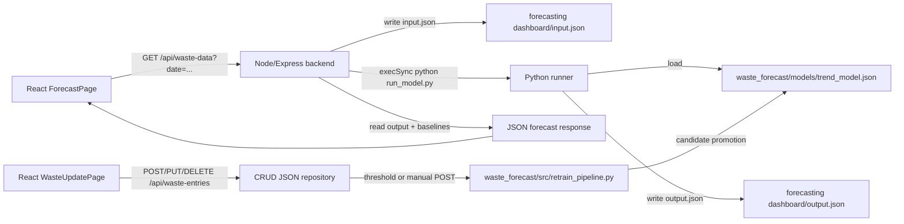

# Forecasting Component Audit

> **Updated 2026-10-19:** model facts corrected. The live model is now `waste_forecast/models/trend_model.json` (weighted OLS trend with unweighted calendar-month effects, fitted by `fit_production_model.py`); `model.json` is archived synthetic-era evidence (`waste_forecast/archive/model.json.synthetic-era` (removed from the working tree; kept in git at `bacf3a3b`, see `waste_forecast/archive/README.md`)), not loaded at runtime; XGBoost is not used in the live forecast path; the target is the eight-council monthly aggregate, not the WPWMA grand total; `historical_baselines.json` uses a trailing 12-month window. Retrain-pipeline findings in section 4 describe the code at audit time.

Audit scope: the `forecasting dashboard/` Python service, forecasting and waste-record CRUD paths in `backend/`, and client screens/calls that use those paths. Computer-vision and object-detection components were not inspected.

## 1. Forecasting component map

| Path | What it does | Language/framework | Connection to forecasting flow |
|---|---|---|---|
| `forecasting dashboard/app.py` | Dash/Plotly research dashboard for landmark geocoding, Calendarific holiday lookup/cache, event flags, and rule-based fill-impact analytics. | Python, Dash, Plotly, Requests, Geopy | Loads `forecasting dashboard/geocode_cache.json` and `holiday_cache.json` at startup (`app.py:102-103`, `app.py:657-658`). It is not the Node `/api/waste-data` demand-model endpoint. |
| `forecasting dashboard/run_model.py` | Reads generated `input.json`, gets the monthly total from `waste_forecast/models/trend_model.json` (weighted OLS trend with unweighted calendar-month effects, fitted by `fit_production_model.py`) via `daily_forecast.py`, disaggregates a daily total by institute/category shares, applies event multipliers, and writes `output.json`. | Python, pandas | Called synchronously by the Node demand endpoint (`backend/routes/wastedata.routes.js:139-152`). |
| `forecasting dashboard/_run_trend.py` | Reads generated trend rows and writes category/date predictions to `output_trend.json`; it also imports the separate `waste_forecast` package. | Python, pandas, XGBoost imports; current calculation is share/rule based | Generated/overwritten by `backend/routes/wastetrend.routes.js:117-144` and executed at `backend/routes/wastetrend.routes.js:221`. |
| `forecasting dashboard/compute_baselines.py` | Evaluates daily values from the current `waste_forecast` model over a trailing 12-month window before the forecast date and writes location Q1/median/Q3/P90 baselines. | Python, NumPy | Intended offline regeneration of `backend/historical_baselines.json`; output path is explicit at `compute_baselines.py:21`. |
| `forecasting dashboard/analyze_model_feature_effects.py` | Loads the legacy pickle estimator and feature list, builds a reference frame from `input.json`, prints tree splits, and writes a PDP image. | Python, scikit-learn inspection, XGBoost pickle | Analysis-only path; it is not called by the API. |
| `backend/routes/wastedata.routes.js` | Builds 8-location × 8-category rows for a selected date, hands them to the Python runner, and returns status/baseline/composition JSON. | Node.js/Express | Live municipal demand forecast route: `GET /api/waste-data` (`wastedata.routes.js:70-311`). |
| `backend/routes/wastetrend.routes.js` | Builds 15 dates × 8 categories, writes trend input, runs Python, and returns 7 historical plus 7 forecast points. | Node.js/Express | Live trend route: `GET /api/waste-trend` (`wastetrend.routes.js:70-270`). |
| `backend/utils/dateUtils.js` | Reads the forecasting-dashboard holiday cache and derives holiday/weekend/Poya/long-weekend flags. | Node.js | Shared by the demand and trend routes (`dateUtils.js:5`). |
| `backend/utils/wasteStatus.js` | Reads `backend/historical_baselines.json` and classifies predicted KG against Q1/Q3/P90. | Node.js | Used while assembling `/api/waste-data` responses. |
| `backend/routes/wasteentries.routes.js` | CRUD for manual records, retrain status, and explicit/threshold retraining triggers. | Node.js/Express | Writes `backend/data/waste_entries.json` through the repository and invokes `waste_forecast/src/retrain_pipeline.py` (`wasteentries.routes.js:22-208`). |
| `backend/repositories/wasteEntries.repository.js` | File-backed repository for manual waste records and `processed_for_training`. | Node.js, JSON file I/O | Persists records in `backend/data/waste_entries.json` (`wasteEntries.repository.js:4`, `wasteEntries.repository.js:28-43`). |
| `frontend/src/pages/ForecastPage.js` | Municipal demand forecast UI; submits the selected date to `/api/waste-data`. | React | Calls `apiUrl("/api/waste-data?...")` (`ForecastPage.js:160-164`). |
| `frontend/src/pages/WasteUpdatePage.js` | Manual waste-record create/edit/delete UI and manual retrain button/status UI. | React | Calls `/api/waste-entries` CRUD and `/trigger-retrain` (`WasteUpdatePage.js:85-244`). |
| `frontend/src/utils/apiBase.js` | Resolves backend base URL from `VITE_API_URL`. | JavaScript | All listed frontend calls use `apiUrl` (`apiBase.js:19-43`). |
| `mobile_app/lib/` | Staff bin/map and public nearest-bin screens. | Dart/Flutter/Riverpod | No forecasting or waste-entry calls were found in the inspected mobile source; searches for `waste-data`, `waste-entries`, and `forecast` returned no matches. |
| `backend/data/waste_entries.json` | Current file-backed CRUD data. | JSON | Training pipeline reads it (`waste_forecast/src/retrain_pipeline.py:21`, `57-64`). |
| `waste_forecast/` dependency | Monthly feature construction, calendar features, model registry, retraining, and the live `trend_model.json` used by the requested service. | Python, pandas, NumPy, scikit-learn | This is a direct dependency of `run_model.py`, `_run_trend.py`, `compute_baselines.py`, and the CRUD retrainer. It is outside the named `forecasting dashboard/` folder and must be treated as a separate dependency surface. |

Out of scope — other group member's component.

## 2. Model inventory — forecasting models only

### Artifact inventory

| Artifact | Size | Classification and confirmation | Training script / save site | Prediction-time loader | Algorithm and hyperparameters | Exact features and target | Metrics |
|---|---:|---|---|---|---|---|---|
| `forecasting dashboard/trained_model.pkl` | 702,859 bytes | Genuine trained estimator: unpickling produced `xgboost.sklearn.XGBRegressor`, not a list/config. | UNKNOWN — no in-scope training script dumps this exact path. Repository search found only the analysis loader at `forecasting dashboard/analyze_model_feature_effects.py:13-15`. | No live loader found. `analyze_model_feature_effects.py:20-28` loads it for PDP analysis only. | XGBRegressor; confirmed parameters include `learning_rate=0.1`, `max_depth=6`, `n_estimators=150`; other parameters are default/`None` as represented by the loaded object. | `forecasting dashboard/model_features.pkl` contains 24 columns: `Is_Weekend`, `Is_Holiday`, `Is_Long_Weekend`, `Rainfall_mm`, `Max_Temp_C`, `Waste_Lag_1`, `Waste_Lag_7`, `Month`, seven institute/category one-hot columns as listed below. Target: UNKNOWN — no training script for this exact pickle was found. | UNKNOWN — no metric file tied to this exact pickle. |
| `forecasting dashboard/model_features.pkl` | 558 bytes | **Not a model**: unpickling produced a Python `list` of 24 column names. | Not applicable. | Only `analyze_model_feature_effects.py:24-28`; no prediction path. | Not applicable. | Feature names only; target not present. | None. |
| `waste_forecast/models/trained_model_daily.pkl` | 361,542 bytes | Genuine trained estimator wrapped in a dict: `{"model": HistGradientBoostingRegressor, "feature_columns": [...], "seed": 42}`. | `waste_forecast/src/train_daily_model.py:84-90` creates `HistGradientBoostingRegressor` and pickles it. | No live loader found. It is referenced as an evaluation artifact in `waste_forecast/evaluation/metrics.json:11`; `daily_forecast.py` loads `model.json`, not this pickle (`daily_forecast.py:18-20`, `88-89`). | `HistGradientBoostingRegressor(max_iter=200, learning_rate=0.05, max_leaf_nodes=15, l2_regularization=0.1, random_state=42)` (`train_daily_model.py:84-87`). | 17 exact columns: `lag_1`, `lag_7`, `lag_14`, `rolling_mean_7`, `rolling_std_7`, `day_of_week_num`, `day_sin`, `day_cos`, `month_sin`, `month_cos`, `is_weekend`, `is_holiday`, `is_off_day`, `is_long_weekend`, `is_long_weekend_bridge`, `n_long_weekend_days`, `n_bridge_days` (`train_daily_model.py:67-72`). Target is reconstructed daily `actual`, derived as monthly `waste_tons * daily_share` (`train_daily_model.py:42-43`, `73-74`). | Five-fold metrics are recorded in `waste_forecast/evaluation/metrics.json:14-92`; mean RMSE 0.04535, MAE 0.03347, MAPE 3.615%, R2 0.95164. The same file explicitly says daily targets were reconstructed from monthly totals (`metrics.json:3-8`, `180-183`). |
| `waste_forecast/models/model.json` (archived as `model.json.synthetic-era`, now only in git at `bacf3a3b`) | 8,166 bytes | **No longer live; archived synthetic-era evidence, not loaded at runtime** (trained on the deprecated ~29 t/month synthetic series, `base_score` 29.67). At audit time: genuine live XGBoost serialized model (JSON format, not one of the requested pickle extensions). The loader constructs `xgb.XGBRegressor` and calls `load_model` (`daily_forecast.py:88-89`; `forecasting dashboard/run_model.py:109-110`). | Initial model provenance is UNKNOWN. Candidate retraining saves/promotes it at `waste_forecast/src/retrain_pipeline.py:88-101`. | `waste_forecast/src/daily_forecast.py:88-89`, reached from `forecasting dashboard/run_model.py:114-118` and `compute_baselines.py:43-44`; the Node endpoint invokes `run_model.py` at `wastedata.routes.js:149`. | Candidate retrain hyperparameters are `n_estimators=10, max_depth=3, learning_rate=0.1` (`retrain_pipeline.py:88`). Initial model hyperparameters are UNKNOWN. | Exact live monthly features are `lag_1`, `lag_2`, `lag_3`, `rolling_mean_3`, `rolling_std_3`, `n_weekend_days`, `n_holidays`, `n_off_days`, `n_long_weekend_days`, `n_long_weekend_events`, `max_long_weekend_length`, `n_poya_days`, `n_bridge_days`, `working_days`, `month_sin`, `month_cos`, `quarter` (`waste_forecast/models/feature_columns.json`; construction at `waste_forecast/src/features.py:32-43`). Target is `waste_tons` (`features.py:46`). | Registry records live/candidate RMSE values (`waste_forecast/models/model_registry.json:1-25`). The values are not independently recomputed here; the retrainer evaluates RMSE in `retrain_pipeline.py:44-50`, `93-99`. |

The live model is not `trained_model.pkl`: the live runner ignores both pickles. At audit time it loaded `waste_forecast/models/model.json`; it now uses `waste_forecast/models/trend_model.json` (weighted OLS trend with unweighted calendar-month effects, fitted by `fit_production_model.py`). The model input rows contain the legacy 24-column shape (`backend/routes/wastedata.routes.js:82-112`), but `run_model.py` uses only date/month plus institute/category shares and calls the monthly/daily `waste_forecast` model (`run_model.py:114-134`). This is a significant naming/documentation inconsistency.

### Explicit answers

**(a) Genuine trained forecasting models:** three serialized estimators were found when the live JSON model is included: the legacy `forecasting dashboard/trained_model.pkl`, the daily pickle `waste_forecast/models/trained_model_daily.pkl`, and the then-live monthly XGBoost `waste_forecast/models/model.json` (now archived; the live model is `trend_model.json`, which is not an XGBoost model). If restricted strictly to the requested pickle/joblib/h5/sav extensions, there are two genuine pickle estimators; `model_features.pkl` is not an estimator.

**(b) Difference:** the legacy pickle is a 24-feature XGBRegressor whose exact target/training provenance is not present in the repository. The daily pickle is a separate 17-feature HistGradientBoostingRegressor targeting reconstructed daily `actual` values (`train_daily_model.py:33-43`, `67-90`). The live model is a monthly `waste_tons` XGBoost model with 17 monthly lag/calendar features (`features.py:32-46`). The daily-vs-monthly distinction is proven by the separate training scripts and target construction, not by filenames.

**(c) Live prediction call chain:**

```text
frontend/src/pages/ForecastPage.js:160-164
  -> GET /api/waste-data
backend/routes/wastedata.routes.js:70-112
  -> write forecasting dashboard/input.json
backend/routes/wastedata.routes.js:139-152
  -> execSync("python run_model.py", cwd=forecasting dashboard)
forecasting dashboard/run_model.py:103-118
  -> load waste_forecast/models/trend_model.json indirectly through estimate_daily_waste()
waste_forecast/src/daily_forecast.py
  -> WeightedTrendModel.load(trend_model.json)
```

**(d) Dead artifacts for the live prediction path:** `forecasting dashboard/trained_model.pkl`, `forecasting dashboard/model_features.pkl`, and `waste_forecast/models/trained_model_daily.pkl`. They are used only by analysis/evaluation/training artifacts, not by `/api/waste-data` or `/api/waste-trend`. `forecasting dashboard/input_trend.json` and `output_trend.json` are live route handoff files, but `_run_trend.py` is generated/overwritten by the route and is not a standalone scheduled process (`wastetrend.routes.js:117-144`).

## 3. Data and cache files

### Schemas, readers, and writers

| File | Schema observed | Writer and regeneration | Reader and purpose |
|---|---|---|---|
| `backend/historical_baselines.json` | Object keyed by eight location IDs. Each value has `locationId:string`, `locationName:string`, `q1Kg:number`, `medianKg:number`, `q3Kg:number`, `p90Kg:number`, `sampleSize:number`, `periodStart:string`, `periodEnd:string`, `method:string`. | `forecasting dashboard/compute_baselines.py:21`, `72-92`; regenerated only when that script is run manually. It computes every date from 2023-01-01 through 2025-12-31 (`compute_baselines.py:32-40`). | `backend/utils/wasteStatus.js:25-30`; used to classify live returned KG values. |
| `forecasting dashboard/geocode_cache.json` | Object keyed by landmark/location name; each value is a two-number array `[latitude:number, longitude:number]`. | `forecasting dashboard/app.py:102`, `179-190`, `257-270`; `_save_json` writes only after successful new geocoding. | `app.py:257-270`, then startup hydration at `app.py:657-658`, for Dash map coordinates. |
| `backend/geocode_cache.json` | Same top-level object/coordinate-array shape, but it contains fewer keys than the dashboard copy. | No writer found in backend; it is a checked-in mirror. | No executable backend reader found; `backend/routes/index.js:42` only describes it in API discovery text. |
| `forecasting dashboard/holiday_cache.json` | Object keyed by year strings; each value is a list of objects with `name:string`, `iso_date:string`, `primary_type:string`. | `app.py:375-384` loads, `app.py:407-446` fetches Calendarific and saves when data is updated. | `app.py:375-384`; also `waste_forecast/src/calendar_features.py:8-25` and Node `backend/utils/dateUtils.js:5`. |
| `backend/holiday_cache.json` | Same year -> holiday-record-list schema as the dashboard copy; observed size/content matches the dashboard copy. | No backend writer found. | No backend code reads this path; backend date utilities explicitly point to the dashboard copy (`dateUtils.js:5`). |
| `forecasting dashboard/input.json` | Array of 64 objects. Fields include `dateStr:string`, `Is_Weekend:int`, `Is_Holiday:int`, `Is_Long_Weekend:int`, `Is_Poya_Day:int`, `Month:int`, `Month_December:int`, `Rainfall_mm:int`, `Max_Temp_C:int`, `Waste_Lag_1:int`, `Waste_Lag_7:int`, plus one-hot institute/category fields. | `backend/routes/wastedata.routes.js:139-148`; regenerated on every `/api/waste-data` request. | `forecasting dashboard/run_model.py:103-104`; analysis script also reads it (`analyze_model_feature_effects.py:15`, `33-36`). |
| `forecasting dashboard/output.json` | Object with `predictions:list[number]`, `reliability:string`, `reliabilityNote:string`; current checked-in prediction list has 64 numbers. | `forecasting dashboard/run_model.py:140-144`; written on success or error. | `backend/routes/wastedata.routes.js:150-159`; converted into location/category response data. |
| `forecasting dashboard/input_trend.json` | Array of 120 objects with the same trend input fields as the main input, except the checked-in rows omit `dateStr`. | `backend/routes/wastetrend.routes.js:117-122`; regenerated on every `/api/waste-trend` request. | Generated `_run_trend.py` reads it (`wastetrend.routes.js:144`, equivalent file `_run_trend.py:21`). |
| `forecasting dashboard/output_trend.json` | Array of 120 numbers, eight categories × 15 dates. | Generated `_run_trend.py:94`; route reads it at `wastetrend.routes.js:222`. | `backend/routes/wastetrend.routes.js:222-230`; reshaped to trend points. |
| `backend/data/waste_entries.json` | Array of records: `id:int`, `entry_date:string`, `vehicle_no:string`, `location_id:string`, `waste_type:string`, `weight_kg:number`, `submitted_at:string`, `processed_for_training:boolean`. | Repository create/update/delete writes it (`wasteEntries.repository.js:28-43`, `139-166`, `174-184`). | CRUD route and retraining pipeline (`wasteentries.routes.js:22-208`; `retrain_pipeline.py:21`, `57-64`). |

The cache copies can drift. The dashboard writes only `forecasting dashboard/geocode_cache.json` and `forecasting dashboard/holiday_cache.json` (`app.py:102-103`, `407-446`), while the backend uses the dashboard holiday path and does not synchronize the backend mirrors (`dateUtils.js:5`, `wastedata.routes.js:52-54`). A manual edit, deployment packaging difference, or regeneration in only one location can therefore change behavior between consumers. The two holiday copies currently match by observed size/top-level content; the geocode copies do not (dashboard has additional entries).

`compute_baselines.py` is an offline baseline generator, not a request-time operation. It loops over the 365 days of the trailing 12-month window before the forecast date × eight locations, calls `estimate_daily_waste(..., mode="forecast")`, computes Q1/median/Q3/P90, and writes `backend/historical_baselines.json` (`compute_baselines.py:32-40`, `52-92`). It is meant to be run after the underlying model/calendar data changes, but no scheduler or automatic invocation was found.

## 4. Architecture and data flow

### Demand forecasting flow



Node-to-Python communication is **child-process execution plus JSON file handoff**, not HTTP: `wastedata.routes.js:139-152` writes `input.json`, calls `execSync("python run_model.py", {cwd:modelDir})`, and reads `output.json`. Trend uses the same mechanism at `wastetrend.routes.js:117-144`, `221-222`. The separate Node `/forecast` route is not this demand model: its controller calls the rule-based `forecastRisk` engine over weather slots (`backend/controllers/forecast.controller.js:1-16`, `55-87`; `backend/services/forecastService.js:1-8`, `76-98`).

### Forecasting and waste-CRUD API routes

| Method | Route | Purpose | Evidence |
|---|---|---|---|
| GET | `/api/waste-data?date=YYYY-MM-DD` | Main 8-location/category municipal demand forecast. | `backend/routes/wastedata.routes.js:70-112` |
| GET | `/api/waste-trend?date=YYYY-MM-DD&location=...` | Seven historical plus seven forecast daily trend points. | `backend/routes/wastetrend.routes.js:70-94`, `240-270` |
| GET | `/api/waste-insights` | Cached seasonal insights from `waste_forecast/src/load_data.py`; fallback JSON on failure. | `backend/routes/wasteinsights.routes.js:8-25` |
| GET | `/forecast?lat=&lon=&hours=` | Rule-based hygienic-risk forecast, not the demand model. | `backend/routes/forecast.routes.js:8-11`; `forecast.controller.js:89-119` |
| GET | `/forecast/:id?hours=` | Device-specific rule-based hygienic-risk forecast. | `backend/routes/forecast.routes.js:8-11`; `forecast.controller.js:36-87` |
| POST | `/api/waste-entries` | Create and persist a manual waste collection record; threshold check may launch retraining. | `backend/routes/wasteentries.routes.js:22-78` |
| GET | `/api/waste-entries` | List/filter/paginate records plus stats. | `backend/routes/wasteentries.routes.js:81-98` |
| GET | `/api/waste-entries/retrain-status` | Report registry and unprocessed count. | `backend/routes/wasteentries.routes.js:101-119` |
| POST | `/api/waste-entries/trigger-retrain` | Synchronous forced retrain. | `backend/routes/wasteentries.routes.js:122-136` |
| PUT | `/api/waste-entries/:id` | Update a record. | `backend/routes/wasteentries.routes.js:139-175` |
| DELETE | `/api/waste-entries/:id` | Delete a record. | `backend/routes/wasteentries.routes.js:178-192` |

## 5. CRUD -> auto-retrain pipeline (root-cause analysis)

### 5.1 CRUD endpoints and persistence

The create, update, and delete endpoints are `POST /api/waste-entries` (`wasteentries.routes.js:22-78`), `PUT /api/waste-entries/:id` (`wasteentries.routes.js:139-175`), and `DELETE /api/waste-entries/:id` (`wasteentries.routes.js:178-192`). They persist to `backend/data/waste_entries.json` through `WasteEntriesRepository.create/update/delete` (`wasteEntries.repository.js:28-43`, `139-166`, `174-184`). The frontend sends exactly five user-entered fields—`entry_date`, `vehicle_no`, `location_id`, `waste_type`, and `weight_kg`—at `frontend/src/pages/WasteUpdatePage.js:157-169`.

### 5.2 Retrain triggers found

1. **Threshold trigger:** after create, if `unprocessedEntries >= 30`, the route launches `python waste_forecast/src/retrain_pipeline.py` asynchronously (`wasteentries.routes.js:55-66`).
2. **Manual endpoint:** `POST /api/waste-entries/trigger-retrain` runs `python waste_forecast/src/retrain_pipeline.py --force` synchronously (`wasteentries.routes.js:122-136`).
3. **Frontend manual button:** the Waste Update page calls that endpoint (`WasteUpdatePage.js:188-200`).
4. **No scheduler found:** no `node-cron`, APScheduler, cron declaration, file watcher, queue, or scheduled retrain loop was found in the in-scope backend/forecasting code. The `setInterval` matches are UI polling, not retraining (`frontend/src/hooks/useSystemSnapshot.js:126`, `frontend/src/hooks/useLiveBinMap.js:146`).

### 5.3 Which failure category is true?

The strongest classification is **(d), with an additional data-feature blocker**: a retrain trigger exists and can fire, but its produced model is not the legacy pickle used by the user-facing analysis and it is not proven to be a valid retraining of the live features.

- The trigger invokes `waste_forecast/src/retrain_pipeline.py`, not `forecasting dashboard/run_model.py` or a script that trains `trained_model.pkl` (`wasteentries.routes.js:64`, `125`).
- The retrainer builds `X, y, feature_cols = build_feature_table()` but `build_feature_table()` loads only the hard-coded `DEFAULT_MONTHLY_WASTE` data (`retrain_pipeline.py:78`; `waste_forecast/src/load_data.py:57-61`), so the manual records are aggregated into `total_all` at `retrain_pipeline.py:67-77` but that modified frame is not passed into `build_feature_table()`. The new records therefore do not actually enter the candidate training table.
- At audit time the retrainer promoted `model_candidate.json` to `waste_forecast/models/model.json` (`retrain_pipeline.py:88-101`); it now promotes to `waste_forecast/models/trend_model.json`, the artifact used by `daily_forecast.py`; it never writes `forecasting dashboard/trained_model.pkl`.
- The asynchronous callback logs an error to stderr (`wasteentries.routes.js:64-66`) but the HTTP response has already returned success with `retrainTriggered: true` (`wasteentries.routes.js:69-75`). This makes background failure easy for the client to miss.
- The live prediction process uses the command name `python` (`wastedata.routes.js:149`, `wastetrend.routes.js:221`), so deployments without a `python` executable can fail; the main demand route catches that failure and returns `UNAVAILABLE` rather than raising it (`wastedata.routes.js:158-166`).

### 5.4 CRUD schema versus training feature set

| Required live/retraining feature | CRUD record provides it? | Evidence/impact |
|---|---|---|
| `entry_date` / date | Partial | CRUD provides `entry_date` (`wasteentries.routes.js:24-34`), but the monthly feature builder uses the static historical table and calendar-derived month rows (`features.py:8-20`, `32-46`). |
| target quantity (`weight_kg` / `waste_tons`) | Partial | CRUD provides `weight_kg`; retrainer converts it to monthly tons (`retrain_pipeline.py:67-73`), but the modified `total_all` is not passed to `build_feature_table()` (`retrain_pipeline.py:78`). |
| `lag_1`, `lag_2`, `lag_3` | No | Derived by `features.py:24-29`; CRUD sends no prior-month series. |
| rolling mean/std | No | Derived by `features.py:29-30`; CRUD sends no history window. |
| `n_weekend_days`, `n_holidays`, `n_off_days` | No | Derived from calendar features, not CRUD fields (`daily_forecast.py:49-61`; `features.py:8-20`). |
| `n_long_weekend_days`, `n_long_weekend_events`, `max_long_weekend_length`, `n_poya_days`, `n_bridge_days`, `working_days` | No | Calendar-derived feature set (`daily_forecast.py:49-61`). |
| `month_sin`, `month_cos`, `quarter` | No | Derived from month (`features.py:35-43`). |
| institute/location contribution | Partial | CRUD has `location_id`, but the monthly live model target is the eight-council monthly aggregate `waste_tons` (not the WPWMA grand total); no location one-hot fields are used by `features.py:32-46`. |
| category contribution | Partial | CRUD has `waste_type`, but the live monthly training table has no category feature; `run_model.py` applies hard-coded `CATEGORY_SHARES` after the aggregate prediction (`run_model.py:121-134`). |
| daily weekday/weekend/holiday flags | No | CRUD provides a date only; the daily pickle’s 17 calendar fields are generated in `train_daily_model.py:46-72`, and that pickle is not live-loaded. |

### 5.5 Most likely root cause

The main root cause is a broken retraining data path: `retrain_pipeline.py` reads manual records and adds their totals to a local `total_all`, but then calls `build_feature_table()` with no argument, causing that function to reload the unchanged hard-coded monthly dataset (`retrain_pipeline.py:67-78`; `waste_forecast/src/load_data.py:57-61`). Even when the trigger fires, the candidate is trained from the static historical table rather than the CRUD data. A second blocker is artifact/path confusion: retraining promoted `waste_forecast/models/model.json` (`retrain_pipeline.py:88-101`; it now promotes `trend_model.json`), while the explicitly named `forecasting dashboard/trained_model.pkl` is never trained or loaded by the live route (`run_model.py:109-118`; `analyze_model_feature_effects.py:20-28`). Finally, update and delete endpoints do not launch retraining at all (`wasteentries.routes.js:139-192`), so the intended “any CRUD change retrains automatically” behavior is absent for two of the three mutations.

### 5.6 Exception handling that can hide forecasting/retraining failure

- `forecasting dashboard/run_model.py:143-145` catches every exception and writes a success-shaped JSON error payload to `output.json`; the Node route then converts it to `UNAVAILABLE` (`wastedata.routes.js:154-166`).
- `backend/routes/wastedata.routes.js:158-166` catches Python/file/JSON failures, logs only the message, and returns a normal JSON response containing unavailable locations.
- `backend/routes/wastetrend.routes.js:42-44` catches any holiday-cache read failure and silently uses `{}`.
- `backend/routes/wastetrend.routes.js:223-230` catches model execution failures and returns a JSON response with an embedded error.
- `backend/routes/wasteentries.routes.js:64-66` logs asynchronous retrain errors only after the create response has returned.
- `backend/routes/wasteentries.routes.js:7-14` silently returns an empty model registry on parse failure.
- `backend/repositories/wasteEntries.repository.js:13-20` logs a JSON read error and returns an empty list, which can make the system appear to have no records.
- `forecasting dashboard/app.py:128-129` ignores dotenv import/load failure.
- `forecasting dashboard/app.py:163-168`, `179-190`, `213`, `248`, `265`, `298`, `321`, `360`, `384`, `735`, `787`, and `945` catch cache/geocoding/calendar/UI exceptions; most log warnings, while several use `continue` or fallback values. These affect the dashboard/cache path rather than CRUD retraining directly.

## 6. How to run it

### Backend

From `C:\Reasearch\SLIIT\R26-IT-084\backend`:

```powershell
npm install
npm start
```

Development mode:

```powershell
npm run dev
```

The scripts are defined in `backend/package.json:8-12`. The server listens on `PORT`, defaulting to 5000 (`backend/server.js:31`; `backend/config/env.js:69`).

### Frontend

From `C:\Reasearch\SLIIT\R26-IT-084\frontend`:

```powershell
npm install
npm run dev
```

Production build/serve:

```powershell
npm run build
npm start
```

Scripts are in `frontend/package.json:14-19`. Set `VITE_API_URL` for a deployed backend; it is read at `frontend/src/utils/apiBase.js:19`.

### Python forecasting service

There is no independent HTTP Python service for the municipal demand endpoint. The backend starts the runner as a child process:

```powershell
cd "C:\Reasearch\SLIIT\R26-IT-084\forecasting dashboard"
python run_model.py
```

That command requires a pre-existing `input.json`; the normal supported way is to call the backend route, which writes it first (`backend/routes/wastedata.routes.js:139-149`). Trend is likewise run by the backend via generated `_run_trend.py` (`wastetrend.routes.js:117-144`, `221`). The Dash research app, if required, is started manually from the same directory with a Dash-compatible Python invocation; the exact `app.run` entrypoint is UNKNOWN — not found in the inspected excerpts.

### Environment variables read by in-scope code (names only)

| Name | Reader |
|---|---|
| `PORT` | `backend/config/env.js:69` |
| `CORS_ORIGIN` | `backend/config/env.js:58-64` |
| `MODEL_WASTE_URL` | `backend/config/env.js:21` |
| `MODEL_ANIMAL_URL` | `backend/config/env.js:22` |
| `MODEL_YOLO_URL` | `backend/config/env.js:23` |
| `MODEL_LITTER_URL` | `backend/config/env.js:24` |
| `DEFAULT_MODEL` | `backend/config/env.js:70` |
| `INFER_TIMEOUT_SECONDS` | `backend/config/env.js:71-72` |
| `MAX_UPLOAD_MB` | `backend/config/env.js:73-74` |
| `DATABASE_URL` | `backend/config/env.js:55` |
| `DB_SYNC` | `backend/config/env.js:78` |
| `DB_SYNC_ALTER` | `backend/config/env.js:79-80` |
| `DB_LOGGING` | `backend/config/env.js:82` |
| `NODE_ENV` | `backend/config/env.js:83` |
| `JWT_SECRET` | `backend/config/env.js:87` |
| `JWT_EXPIRES_IN` | `backend/config/env.js:88` |
| `ADMIN_INVITE_SECRET` | `backend/config/env.js:89` |
| `OPENWEATHER_API_KEY` | `backend/config/env.js:91` |
| `DEFAULT_WEATHER_LAT` | `backend/config/env.js:92` |
| `DEFAULT_WEATHER_LON` | `backend/config/env.js:93` |
| `HIGH_TEMP_C` | `backend/config/env.js:94` |
| `HIGH_HUMIDITY_PCT` | `backend/config/env.js:95` |
| `CALENDARIFIC_API_KEY` | `forecasting dashboard/app.py:140-147` |
| `LOG_LEVEL` | `forecasting dashboard/app.py:112-116` |
| `VITE_API_URL` | `frontend/src/utils/apiBase.js:19` |
| `VITE_LIVE_DEVICE_ID` | `frontend/src/components/LiveEsp32View.js:7` |
| `VITE_ESP32_CAPTURE_URL` | `frontend/src/pages/HomePage.js:56` |

`forecasting dashboard/app.py:125-127` attempts to load `.env` from the dashboard directory. The backend loads `.env` through `dotenv` in `backend/config/env.js:1`; the frontend receives Vite variables at build time.

## 7. Risks and gaps

1. **Retraining does not consume CRUD data:** the local merged `total_all` is discarded before feature construction (`retrain_pipeline.py:67-78`).
2. **CRUD update/delete never trigger retraining:** only create threshold and explicit manual endpoint do (`wasteentries.routes.js:55-66`, `139-192`).
3. **Artifact identity is misleading:** `trained_model.pkl` is a real estimator but dead in production; the live estimator is `waste_forecast/models/trend_model.json` (weighted OLS trend with unweighted calendar-month effects, fitted by `fit_production_model.py`) (`model.json` was live at audit time and is now archived).
4. **Feature-contract mismatch:** the endpoint builds legacy daily/location/category rows, while the live model is trained on aggregate monthly lag/calendar features (`wastedata.routes.js:82-112`; `features.py:32-46`).
5. **Static training source:** `load_waste_data()` ignores its `workspace_root` argument and returns `DEFAULT_MONTHLY_WASTE` (`load_data.py:57-61`), so the retraining claim is not supported by the actual data path.
6. **Synthetic daily evaluation:** metrics explicitly use daily targets reconstructed from monthly totals and a profile (`metrics.json:3-8`, `180-183`); this should be disclosed prominently in a dissertation.
7. **Hard-coded forecast horizon:** `daily_forecast.py:22-25` caps the reliable horizon at 2026-12-31, despite current audit date being 2026-10-18 and future use requiring explicit maintenance.
8. **Hard-coded weather inputs:** demand route rows use `Rainfall_mm: 0`, `Max_Temp_C: 30`, and both lag values `15` (`wastedata.routes.js:91-102`).
9. **Hard-coded location coordinates and names:** all eight locations are embedded in the route (`wastedata.routes.js:25-34`), while geocode caches are separate and not used for these forecast coordinates.
10. **File-handoff concurrency risk:** every request overwrites shared `input.json`/`output.json`; concurrent requests can race because there is no per-request directory, lock, or request identifier (`wastedata.routes.js:139-152`).
11. **Unsafe executable assumption:** routes invoke bare `python`, not a configured interpreter (`wastedata.routes.js:149`; `wasteentries.routes.js:64`, `125`), making deployment/runtime selection fragile.
12. **Silent/fallback behavior:** model and cache failures become empty/fallback data rather than a hard failure (`wastedata.routes.js:158-166`; `wastetrend.routes.js:42-44`, `223-230`).
13. **Cache duplication:** `backend/geocode_cache.json` and `forecasting dashboard/geocode_cache.json` differ in key count, while backend holiday code reads the dashboard copy (`dateUtils.js:5`). This can produce environment-dependent map/calendar behavior.
14. **No automatic baseline refresh:** `compute_baselines.py` writes baselines only when manually run (`compute_baselines.py:72-92`); retraining does not regenerate them.
15. **Manual retrain status can be misleading:** registry parsing failures return an empty registry (`wasteentries.routes.js:7-14`), and asynchronous failures are only logged (`wasteentries.routes.js:64-66`).
16. **Checked-in generated state is stale-prone:** `input.json`, `output.json`, trend files, caches, model registry, and model artifacts are mutable runtime/training outputs but are committed alongside source. No reproducible generation command is wired into the normal server startup.
