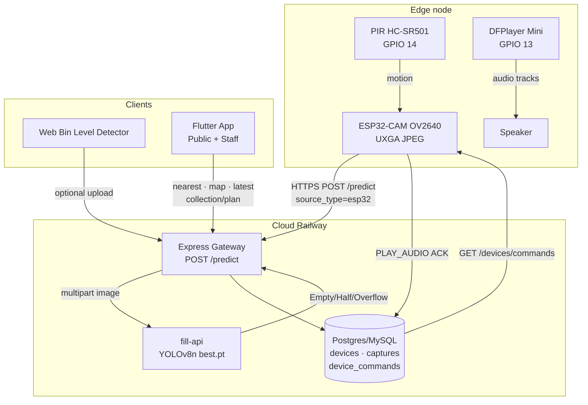

# Figure: System Architecture (Bin Fill + IoT + Mobile)

**Suggested caption:**  
*Figure 1. Edge–cloud–mobile architecture for vision-based bin fill monitoring in VisionWaste (R26-IT-084).*

Copy the Mermaid block into [mermaid.live](https://mermaid.live) → Export PNG/SVG → insert in Word.

## Text for thesis (short)

The system comprises three layers: (i) an ESP32-CAM edge node that captures JPEG frames on PIR motion and polls cloud commands for DFPlayer audio; (ii) a cloud gateway that invokes the fill-api YOLOv8n microservice and persists fill tiers; (iii) Flutter and web clients that consume device fill state for citizen nearest-bin guidance and staff collection planning.
